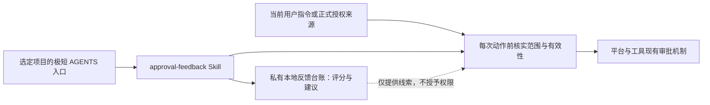

# 审批反馈 Skill 总体纲领

日期：2026-11-01
状态：设计提议，未实施；本轮扩展连续交付、执行偏好及 Git 自动化设计。本文与[详细执行计划](APPROVAL_FEEDBACK_EXECUTION_PLAN_2026-11-01.md)构成本次两份交付文件；阅读、采纳设计或完成文档交付，不表示批准安装、修改项目入口或启用任何免重复确认规则。

## 1. 目标与成功标准

减少没有决策价值的人工打断，让用户对“这次确认是否值得”给出低负担反馈，再将稳定反馈转为一次范围明确的授权建议。效果以重复询问减少、分类正确、评分负担低衡量，不追求免审率。

首先复用已有授权：任务已经明确授权、范围没有实质变化且平台允许执行时，直接继续，不为积累评分再询问。评分用于处理剩余的不确定类别，不能取代对当前任务与权限的判断。

第一版不建设审批平台、数据库、MCP 服务、评分 UI、后台监控或自动点击批准工具；不跳过 CI、Gate、独审，不改变工具强制审批，也不承诺跨客户端自动通用。

## 2. 三种对象分别处理

| 对象 | 处理方式 | 评分能改变什么 |
|---|---|---|
| Agent 自身发出的确认请求 | 先检查已有授权；确需用户选择时再问 | 发现多余询问，形成明确范围的后续处理约定 |
| CI、Gate、代码独审等质量检查 | 按项目要求保留并自动执行允许的检查 | 不因低分删减质量证据；没有人工问答的检查不计审批样本 |
| 平台或工具强制审批 | 使用该平台支持的正式机制；必须当次确认的仍当次确认 | 只能提出改进建议；Skill、AGENTS 和反馈台账不能自行解除限制 |

创建长期凭据、安全设置变更、具体 PR 批准等被所在环境要求当次确认的事项，不因历史低分免除。dot 正式规则、本地 Codex 及其他工具的审批边界分别核实；工具可见或调用成功，不等于已获授权。

## 3. 最小架构与渐进式披露

| 部分 | 责任 | 保持简单的约束 |
|---|---|---|
| `approval-feedback` Skill | 区分对象、核实授权、比较变化、可选评分、独立样本去重、提出建议 | `SKILL.md` 保存核心决策流程；案例过长时才拆一份按需参考文件 |
| 项目 `AGENTS.md` | 在 agent 准备提出确认时提示使用 Skill | 仅选定项目的一小段入口；不复制评分历史、长流程和平台配置 |
| 私有本地小台账 | 保存用户实际反馈、来源引用、去重依据和建议状态 | 单一写入者；不进 Git，不放 Skill 源码、生成物、部署状态或会话原文 |
| 当前有效授权及平台设置 | 决定允许执行的范围、限制与撤销 | 台账只指向原始来源，不保存可独立生效的隐藏权限副本 |

仓库已有 `skills-source/` 单一源、`build-skills.ps1`、环境选择和 `deploy-skills.ps1`。未来源码沿用 `skills-source/shared/approval-feedback/`，生成物不手改，live root 只走现有部署流程。部署 Skill 的许可与取消某类询问的许可分开；每次 live Apply 仍按本仓库现行要求取得授权。

渐进披露分三层：名称与描述用于发现；`SKILL.md` 只放日常判断；需要辨别反例时才读案例。没有真实复用需求就不加脚本、参考文件或跨平台适配层。

## 4. 评分协议

评分问题固定为：**这次打断有没有决策价值？** 不是动作风险评分，也不是本次执行许可。

| 分数 | 用户含义 | 后续含义 |
|---|---|---|
| 0 | 不用问，也无需单独通知 | 可作为减少同类打断的反馈；不压掉异常、阻塞或必要结果报告 |
| 1 | 不用问，结果告诉我即可 | 可作为减少同类打断的反馈；结果并入原任务汇报 |
| 2 | 需要我作选择 | 检查分类或请求里缺少的选项，不能被低分平均掉 |
| 3 | 本类应保留逐次确认 | 暂停该范围的免重复确认建议；如涉及已有约定，按第 7 节核实并暂停依赖 |

只在本来需要用户回复的请求末尾附一行，评分可选，不再单独追问，不因未评分阻塞已获许可的工作。平台弹窗无法附文字时，只在相关任务说明中提供一次可选反馈入口，不制造第二轮确认。

示例：

> 本次拟执行：在已说明的目标上重开同一 G1；新增变化：仅修正启动前路径格式，已确认前次模型未启动，预算与外部副作用不变。本次是否同意？审批价值可选评 0–3 分。

实际请求须使用当时核实的目标与预算，上述句子本身不证明已有授权。

- “同意，1 分”：分别记录本次许可和反馈；许可仍受本次范围与平台限制。
- “1 分”：只记录反馈；若动作原本缺少许可，继续等待本次许可。
- “同意”：按明确范围继续，不计评分样本，也不催评分。
- 没有回复：不推定同意、不补分；原本已有授权的独立工作可继续。
- “不做，0 分”：本次不执行，反馈照记；该否定样本不计入免重复确认建议阈值。

若同时出现“以后都别问”等明确后续指令，单独解释其范围，不能仅由分数推断。具体动作未定、语义矛盾时，只澄清影响执行的那个问题。

## 5. “同类”与独立样本

类别用一行表达：**项目／环境 + 对象 + 动作 + 数据与目的地 + 预算上限 + 例外**。可写“沿用该任务已明确的预算”，但原始预算必须可核实。初期用人工可读短名，不设计通用分类引擎或风险权重。

默认不跨项目、客户端或平台迁移授权。目标、目的地、数据类别、权限、费用预算或外部副作用变化，要重新判断，不能沿用旧类结论。混合请求按真正需要许可的动作拆清范围，但不要求拆成多轮对话。例如只读核包不覆盖启动探针，设备就位不等于内容采集许可。

样本单位是独立任务中的一次用户判断：同一任务的重试、拆分步骤和重复询问合并计一次。跨会话继续同一任务仍算同一份；无法证明独立就不计入阈值。原始反馈不删改，同任务后续出现 2／3 分或否定执行时，优先阻止该样本支持免重复确认。

## 6. 阈值只产生建议

拟定起点：**同一明确范围，三个独立任务分别获得 0–1 分，期间没有 2–3 分或未解决的反例，且没有本次许可冲突，才触发一次授权建议。** 这是可调整的产品假设，不是安全证明。

没有评分、历史候选案例、agent 推测、拆开的重试均不算用户评分。不得用平均分覆盖 2／3 分；有反例先查是否混类，保留原记录，明确收窄后的范围再重新积累，不偷偷挑掉高分。用户拒绝或暂缓建议后不在每次请求中重复推销；只有用户重新提出或范围实质变化才再考虑。

建议必须可直接审阅：明确项目／环境、动作、对象、目的地、数据、预算、例外、结果通知方式、有效期限或结束条件、撤销方法、适用客户端和授权保存位置。例如 PINN 指定仓库与分支的已审核源码／文档推送，不含原始数据、首次目的地、强推、合并和发布。实际仓库与分支须到实施时核实，不用示例代填。

用户确认后，按其真正批准的范围执行；若要持久化项目指令或正式平台规则，只有在用户授权包含该写入且正式入口可用时才保存。能够直接消除的多余 agent 询问，不为此额外建设平台规则。已有规则明确要求逐次许可的事项，在获得并落实对应规则变更前保持原要求。

## 7. 生效、撤销与失败边界

每个下一步动作前，以当前可读取的用户指令、已批准项目约定或平台正式规则核实授权；台账中的来源引用和“已建议／已确认”只是线索。无可核实来源时，不依赖自动处理。上下文缓存不延长授权，不把某会话的批准默认为其他会话通用。

用户说“这类以后问我”、出现反例或发现分类不符时，立即暂停后续动作对此范围约定的依赖，记录原因，核实正式来源并按授权收窄或撤销。0／1 分不会自行再次恢复。评分不形成持续自动升降权限的控制器。

跨会话不能承诺瞬时撤销：在没有可共同读取、能反映当前撤销状态的正式来源时，第一版仅适用于能够核实当前约定的会话；不承诺靠私有台账同步权限。已经开始或完成的动作不能被“撤销规则”瞬间回退，先核实状态，补救动作另依权限执行。

执行结果不明先读回，不盲目重试。明确访问拒绝后不换路径、工具或执行身份绕过；503 等服务不可用属于执行故障，不计为安全审批拒绝。台账写入失败不阻塞已合法获批的工作，但该反馈未可靠保存就不参与阈值判断，亦不为补台账发起额外确认。

## 8. 试点与验收原则

建议先在 Bridge 与 PINN 做“建议／记录”试点，所有现有权限与质量门禁保持生效；试点安装和项目入口修改属于未来实施。三个真实独立评分到达之前，可以完成设计、模拟和正常任务，不能承诺采样完成日期。

现有只读抽查提供的是候选辨别例，不是评分或授权：

- PINN 同仓同分支源码／文档的两条、三条提交推送分别申请，说明不含原始 MAT；首次目的地、强推、合并、发布或新增数据需要另分。
- Bridge 路径 literal 不匹配、模型未启动后，修正同一 G1 的路径格式再申请，是重复询问候选；新增缓存落点或子线程不能硬封顶的信息不应混算。
- mobile 的核包与启动探针需分清；harness 的 CI／Gate／独审若无对应人工问答，不计无意义审批。

这些例子来自本次讨论所提供的抽查摘要，本文没有重新读取原始会话；不据此推算审批总数、浪费率或节省时间。

第一版验收关注：已授权同范围动作不再重复问；无明确授权不执行；评分与许可分离；重试不虚增样本；反例能暂停；平台必需确认保留；评分只多一行且不追问。失败时暂停对应范围，保留必要任务报告，按现有部署与项目约定恢复，不引入全局熔断系统。

连续交付、执行偏好及提交／推送／合并自动化见第 9–11 节；具体落点、任务输入输出、串并联关系、场景验收和回退见[详细执行计划](APPROVAL_FEEDBACK_EXECUTION_PLAN_2026-11-01.md)。

## 9. 扩展评分：连续交付与执行偏好

扩展方向是减少执行中的无价值打断，覆盖阶段衔接、失败恢复、等价方案和资源安排。不是所有动作都要先评分：已有授权及项目规则已覆盖的实现、验证、相关修复、提交和推送直接推进，不等待三个低分，也不为采样新增确认。

| 决策类型 | 候选问题 | 可形成的窄范围约定 |
|---|---|---|
| 阶段衔接 | 完成实现后是否继续测试、修复、提交 | 在当前任务验收范围内连续推进，遇到范围变化或必要选择再问 |
| 失败恢复 | 启动前修正、已确认未生效后的重试 | 先核实执行状态；在原目标、预算、副作用及有限重试约定内恢复 |
| 等价方案选择 | 复用已有库还是新增依赖，选哪种满足要求的实现 | 按已确认的偏好选择改动更小、依赖更少的可行方案；影响接口、交付或运维成本时重新判断 |
| 工具与并行安排 | 使用哪个已许可工具，是否拆分独立工作 | 在已授权工具、容量、费用和写入隔离约束内安排；工具可用不等于调用获准 |
| 检查后的处置 | 是否修复当前交付的直接阻塞 | 自动修复相关失败并定向复验；无关问题记录后续，必需门禁保留 |
| 预算内资源分配 | 是否增加一次实验或模型调用 | 只有授权明确覆盖调用及总额、单次上限、轮次和停止条件时才自动安排；次数与费用不能相互替代 |
| 通知与汇报 | 是否单独通知常规阶段完成 | 按 0／1 分及明确约定合并通知，异常、阻塞和必要结果仍报告 |

保持一套用户评分：0–3 仍只表示“这次打断有没有决策价值”。台账仅在确有请求时增加一个决策类型短名，不建立综合风险分、用户信任分或自动升降权阈值。原有三独立任务规则适用于需要新增处理约定的候选类别；用户直接明确授权时不强求采样。

方案偏好是第二种信息，应与打断评分分开。用户明确表达的“优先复用、最小改动、先复现再修复”等可按其适用范围使用；成功完成一次或连续低分不证明用户偏好某种技术方案。可以结合真实反馈提出偏好建议，跨任务保存前给出精确内容与范围并取得相应写入授权；不把推测保存成事实，不擅自扩大到全局。

客观证据只记录已有任务结果中的验收是否通过、返工、预算及用户纠正；未知就标未知。不要求用户每个阶段评价，不给普通工具调用、检查或完成通知附评分，也不把通过测试换算成用户低分。失败先排查执行、分类或授权问题，不能仅因一次正常故障就撤销全部自动化约定。

## 10. 提交、推送与合并的自动化

三种动作分别核实授权，可在同一个可审阅的任务约定中一次说清。评分用于发现多余确认和提出后续约定，不是执行开关。

| 动作 | 自动执行前的条件 | 完成证据与停止边界 |
|---|---|---|
| 提交 | 当前任务及项目规则允许；拥有该工作树；差异和暂存区已复核；必需检查通过 | 记录完整提交 SHA，确认仅含本任务内容；不混入其他 WIP、生成物、凭据或机器私有数据 |
| 普通推送 | 授权覆盖本仓库、实际远端／目标分支及数据类别；远端地址和待推送提交已核实；检查通过 | 读回远端 ref 与本地提交关系；不包含强推、新目的地、额外数据或分支删除 |
| 合并 | 当前任务有合并许可；实际 PR／源分支、目标分支、方式和结束条件明确；最新候选满足 CI、必需独审、保护与合并队列规则 | 读回 PR 合并状态、最终合并 SHA 与目标分支包含关系；不自行代替要求的人类审查，不跳过门禁 |

本仓库当前已经要求经验证后正常提交和推送，不需要先打分才执行；同时明确要求每个任务的合并取得 owner 显式授权。因此近期可行方式是用户在当次任务明确授权“满足约定条件后合并”，执行者完成检查后直接合并，或在平台正式支持时启用该 PR 的原生自动合并／合并队列。启用自动合并本身也须在许可范围内，不使用管理员 bypass、自动点击批准或自建轮询服务。

如希望跨任务持续自动合并，需另行审阅并明确授权修改本仓库或目标项目的“每任务合并许可”条款，写清适用范围与例外，再按平台要求配置正式入口；只安装 Skill、批准本文或给低分均不完成该变更。本轮不修改项目审批条款、不启用自动合并、不执行任何合并。

建议跨任务试点从本仓库获准的 `codex/*` 任务分支、既有 `origin` 对应仓库及 `main` 目标开始，仅覆盖普通说明文档；审批／授权设计文档、`AGENTS.md`、审批 Skill、CI／门禁、安全与部署配置不在首批自动合并范围。每次仍核实远端身份、实际文件和差异；不能只看扩展名或路径匹配。授权策略自身的修改不能由它授予的自动合并许可批准。扩大到源码、脚本或 Skill 时，另行确定其检查、独审及范围，获得对应规则变更许可后才扩展。

合并许可应绑定实际任务及 PR，核实其当前 head、base、数据范围与合并方式。新增提交、冲突修复、base 推进时，重新核实内容与必需门禁；在原许可范围内的常规修复不机械要求重新授权，但范围、目标、数据或副作用改变则停下重新判断。不能用旧 head 的绿灯批准新内容；平台要求合并队列时，以队列生成候选的必需检查为准。授权须说明允许入队等待及有效期，无法核实有效性就不启用。

PR 拒绝、未解决审查、无权限或保护规则阻塞时保留阻塞，不换方式绕过。提交、推送或合并返回不明时先读回本地与远端状态；推送被拒绝不改用强推，合并超时不直接重复。停止自动合并须取消已登记的原生自动合并或队列请求并读回；只暂停 Skill 不会取消平台已接受的请求。已完成合并需要按权限另提 revert／修复方案，不能承诺撤销规则可回滚历史。远端分支删除始终单独核实授权，不能附带在合并中。

## 11. 一份任务执行约定，两个独立生效来源

任务约定可以一次列清：项目与客户端、交付及验收、允许的连续阶段、方案偏好、工具／并行边界、预算与恢复限额、提交／推送／合并各自范围、通知、有效期和撤销方法。只列当前任务真正需要的项，不建设通用策略引擎。任务授权与平台许可分别满足：任务约定不能突破平台限制，平台放行也不能补足任务授权。

示意语义是：“本任务允许实现、必需检查、修复直接相关失败、提交并向已核实的目标推送；该任务的指定 PR 满足最新 CI、必需独审和保护规则后，可按批准方式自动合并。优先复用已有依赖。超出交付范围、数据目的地或费用上限时停止相关动作并请求选择。”这段文字是待具体化的模板，不是当前执行许可；真实请求必须附实际仓库、远端、分支、PR／任务关联、方式、预算及有效期，不能照抄示例代填。

实施时沿用第 3 节的 Skill、短入口、私有台账和正式授权来源。先把连续交付与有限恢复做实，再根据真实任务提出偏好与 Git 自动化约定；三者不必建设三个系统，也不必等待评分才能执行原本已有授权的工作。具体任务和扩展场景见执行计划第 7–8 节。
