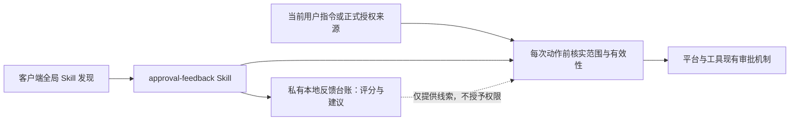

# 审批反馈 Skill 总体纲领

> 历史设计与实施记录（2026-11-01）。2026-11-11 已取消等待多个独立评分任务才提出扩权的门槛，
> 并明确项目级持续授权、继承及权限中性整理的通知边界。当前执行依据见
> [Skill](../skills-source/shared/approval-feedback/SKILL.md)、[使用手册](README.md#13-harness-environments)和 [STATUS.md](../STATUS.md)；下文旧阈值及逐次授权描述保留为历史，不作现行要求。

日期：2026-11-01
状态：基础 Skill 及“编号＋同次许可／可选评分”修订均已完成用户逐次授权的三平台更新与哈希核验；实际同次 Ask 已获得本次许可及可选反馈，反馈仅保存在私有台账。新增长期授权仍须分别核实。本文与[详细执行计划](APPROVAL_FEEDBACK_EXECUTION_PLAN_2026-11-01.md)保存设计依据和实际实施证据；阅读、采纳设计或安装 Skill 不表示启用任何免重复确认规则。

## 1. 目标与成功标准

减少没有决策价值的人工打断，让用户对“这次确认是否值得”给出低负担反馈，再将稳定反馈转为一次范围明确的授权建议。效果以重复询问减少、分类正确、评分负担低衡量，不追求免审率。

首先复用已有授权：任务已经明确授权、范围没有实质变化且平台允许执行时，直接继续，不为积累评分再询问。评分用于处理剩余的不确定类别，不能取代对当前任务与权限的判断。

第一版不建设审批平台、数据库、MCP 服务、独立评分 UI、后台监控或自动点击批准工具；仅复用现有 Ask 的选项或文字能力，不改原生批准按钮。不跳过 CI、Gate、独审，不改变工具强制审批，也不承诺跨客户端自动通用。

## 2. 三种对象分别处理

| 对象 | 处理方式 | 评分能改变什么 |
|---|---|---|
| Agent 自身发出的确认请求 | 先检查已有授权；确需用户选择时再问 | 发现多余询问，形成明确范围的后续处理约定 |
| CI、Gate、代码独审等质量检查 | 按项目要求保留并自动执行允许的检查 | 不因低分删减质量证据；没有人工问答的检查不计审批样本 |
| 平台或工具强制审批 | 使用该平台支持的正式机制；必须当次确认的仍当次确认 | 只能提出改进建议；Skill、AGENTS 和反馈台账不能自行解除限制 |

创建长期凭据、安全设置变更、具体 PR 批准等被所在环境要求当次确认的事项，不因历史低分免除。dot 正式规则、本地 Codex 及其他工具的审批边界分别核实；工具可见或调用成功，不等于已获授权。

## 3. 最小架构与渐进式披露

| 部分 | 责任 | 保持简单的约束 |
|---|---|---|
| `approval-feedback` Skill | 区分对象、核实授权、比较变化、可选评分、独立样本去重、提出建议 | `SKILL.md` 保存核心决策；规则修订与 Git 执行按需读随包部署的 `references/workflows.md`，不复制整套验收案例 |
| 客户端全局发现／可选项目入口 | 三平台全局 skills 部署后由客户端发现，适用于任意仓库 | 不要求逐项目写 `AGENTS.md`；确有单项目路由需要时才提出获准的短入口，不复制权限白名单或评分历史 |
| 私有本地小台账 | 保存用户实际反馈、来源引用、去重依据和建议状态 | 单一写入者；不进 Git，不放 Skill 源码、生成物、部署状态或会话原文 |
| 当前有效授权及平台设置 | 决定允许执行的范围、限制与撤销 | 台账只指向原始来源，不保存可独立生效的隐藏权限副本 |

仓库沿用 `skills-source/` 单一源、`build-skills.ps1`、环境选择和 `deploy-skills.ps1`。源码位于 `skills-source/shared/approval-feedback/`，选入三平台 `work/full`，生成物不手改，live root 只走现有部署流程。部署 Skill 的许可与取消某类询问的许可分开；每次 live Apply 仍按本仓库现行要求取得授权。

渐进披露分三层：名称与描述用于发现；`SKILL.md` 只放日常判断；需要辨别反例时才读案例。没有真实复用需求就不加脚本、参考文件或跨平台适配层。

## 4. 评分协议

评分问题固定为：**这次打断有没有决策价值？** 不是动作风险评分，也不是本次执行许可。

| 分数 | 用户含义 | 后续含义 |
|---|---|---|
| 0 | 不用问，也无需单独通知 | 可作为减少同类打断的反馈；不压掉异常、阻塞或必要结果报告 |
| 1 | 不用问，结果告诉我即可 | 可作为减少同类打断的反馈；结果并入原任务汇报 |
| 2 | 需要我作选择 | 检查分类或请求里缺少的选项，不能被低分平均掉 |
| 3 | 本类应保留逐次确认 | 暂停该范围的免重复确认建议；如涉及已有约定，按第 7 节核实并暂停依赖 |

每个真正需要回复的确认附会话内短编号（如 `A01`），绑定任务、客户端、具体动作与范围；补评分沿用该号，编号不全局唯一，不代表权限。已有授权的动作不为编号或评分再问。

必要新询问发出前核对当前交互段，实际输出须包含编号、可省略的评分入口及分数含义，不能只附“可选评 0–3 分”。Skill 更新、上下文恢复后版本不明或仍沿用旧模板时重新读取该段；全局入口刷新、曾读取或声称启用不证明已使用当前正文。已发出的待答请求不为升级重发，已有许可不重问；纯事实澄清不附评分。全局入口保留这组最小输出要求，详细选项与归并规则仍以 Skill 为准。

当前允许的 Ask 支持足够选项时，同一次选择分别表达本次许可和可选评分：提供“本次批准，不评分”、批准加 0／1／2／3 的明确含义，以及“不批准，不评分”；不预选或推荐低分，不把未提交预选当回复。选项数受限或原题是方案选择时，保留原选择、仅附一行带编号和含义的回复模板，不枚举所有方案与分数组合，也不另开评分题。选择方案不扩大为部署／发送许可。

原生批准弹窗保留原按钮；能在理由或相关说明展示时，一次关联编号与动作，并明确补评格式 `A01=1`。点击批准不自动产生评分，不以“刚才那次”为默认指引。没有编号展示能力或用户引用不清时，不猜归属；未关联反馈不计阈值，不为补评分追问或阻塞已有合法许可。多次待决请求导致许可范围不清时，只澄清执行所缺决定。

示例：

> A01｜拟在已说明的目标上重开同一 G1。仅修正启动前路径，已确认前次模型未启动，预算与外部副作用不变。本次是否批准？可回复「批准」或「批准；1分」；评分可省略。0不用问不单报／1结果告知／2需要选择／3逐次确认。

实际请求须使用当时核实的目标与预算，上述句子本身不证明已有授权。

- “同意，1 分”：分别记录本次许可和反馈；许可仍受本次范围与平台限制。
- 同一次选择“本次批准＋2／3 分”仍具有其明确的本次许可；高分阻止后续免确认依赖，不抹掉当前许可，也不因评分再问一次。
- `A01=1` 只补对应反馈，不重复已执行动作。兼容“同意／1分”等旧回复，只有来源唯一可核实时才关联；未关联评分不催填、不计阈值。
- “1 分”：只记录反馈；若动作原本缺少许可，继续等待本次许可。
- “同意”：按明确范围继续，不计评分样本，也不催评分。
- 没有回复：不推定同意、不补分；原本已有授权的独立工作可继续。
- “不做，0 分”：本次不执行，反馈照记；该否定样本不计入免重复确认建议阈值。

若同时出现“以后都别问”等明确后续指令，单独解释其范围，不能仅由分数推断。具体动作未定、语义矛盾时，只澄清影响执行的那个问题。

## 5. “同类”与独立样本

类别用一行表达：**项目／环境 + 对象 + 动作 + 数据与目的地 + 预算上限 + 例外**。可写“沿用该任务已明确的预算”，但原始预算必须可核实。初期用人工可读短名，不设计通用分类引擎或风险权重。

默认不跨项目、客户端或平台迁移授权。目标、目的地、数据类别、权限、费用预算或外部副作用变化，要重新判断，不能沿用旧类结论。混合请求按真正需要许可的动作拆清范围，但不要求拆成多轮对话。例如只读核包不覆盖启动探针，设备就位不等于内容采集许可。

样本单位是独立任务中的一次用户判断：同一任务的重试、拆分步骤和重复询问合并计一次。跨会话继续同一任务仍算同一份；无法证明独立就不计入阈值。原始反馈不删改，同任务后续出现 2／3 分或否定执行时，优先阻止该样本支持免重复确认。

## 6. 阈值只产生建议

拟定起点：**同一明确范围，三个独立任务分别获得 0–1 分，期间没有 2–3 分或未解决的反例，且没有本次许可冲突，才触发一次授权建议。** 这是可调整的产品假设，不是安全证明。

没有评分、历史候选案例、agent 推测、拆开的重试均不算用户评分。不得用平均分覆盖 2／3 分；有反例先查是否混类，保留原记录，明确收窄后的范围再重新积累，不偷偷挑掉高分。用户拒绝或暂缓建议后不在每次请求中重复推销；只有用户重新提出或范围实质变化才再考虑。

建议必须可直接审阅：明确项目／环境、动作、对象、目的地、数据、预算、例外、结果通知方式、有效期限或结束条件、撤销方法、适用客户端和授权保存位置。例如 PINN 指定仓库与分支的已审核源码／文档推送，不含原始数据、首次目的地、强推、合并和发布。实际仓库与分支须到实施时核实，不用示例代填。

用户确认后，按其真正批准的范围执行；若要持久化项目指令或正式平台规则，只有在用户授权包含该写入且正式入口可用时才保存。能够直接消除的多余 agent 询问，不为此额外建设平台规则。已有逐次许可要求先按第 12 节核实其效力、范围和当前任务授权：有效的当次明确授权可以满足该要求，不必先修改规则文件；跨任务取消该要求则须获准并落实对应规则变更。不能覆盖的更高优先级限制及平台硬确认仍保持生效。

## 7. 生效、撤销与失败边界

每个下一步动作前，以当前可读取的用户指令、已批准项目约定或平台正式规则核实授权；台账中的来源引用和“已建议／已确认”只是线索。无可核实来源时，不依赖自动处理。上下文缓存不延长授权，不把某会话的批准默认为其他会话通用。

用户说“这类以后问我”、出现反例或发现分类不符时，立即暂停后续动作对此范围约定的依赖，记录原因，核实正式来源并按授权收窄或撤销。0／1 分不会自行再次恢复。评分不形成持续自动升降权限的控制器。

跨会话不能承诺瞬时撤销：在没有可共同读取、能反映当前撤销状态的正式来源时，第一版仅适用于能够核实当前约定的会话；不承诺靠私有台账同步权限。已经开始或完成的动作不能被“撤销规则”瞬间回退，先核实状态，补救动作另依权限执行。

执行结果不明先读回，不盲目重试。明确访问拒绝后不换路径、工具或执行身份绕过；503 等服务不可用属于执行故障，不计为安全审批拒绝。台账写入失败不阻塞已合法获批的工作，但该反馈未可靠保存就不参与阈值判断，亦不为补台账发起额外确认。

## 8. 试点与验收原则

按后续用户明确选择，接入方式为 Claude、Codex、ZCode 三平台全局发现，适用于任意仓库，不要求接入 Bridge／PINN 的项目入口。建设与预演完成后，用户另行授权了本次 `full -Apply`，现已安装并核实 live 与源一致；新任务实际加载另验。全局可发现不迁移项目权限，所有现有授权与质量门禁保持生效；未来每次 live Apply 仍按实际要求取得许可。三个真实独立评分到达之前，可以完成模拟和正常任务，不能承诺采样完成日期。

现有只读抽查提供的是候选辨别例，不是评分或授权：

- PINN 同仓同分支源码／文档的两条、三条提交推送分别申请，说明不含原始 MAT；首次目的地、强推、合并、发布或新增数据需要另分。
- Bridge 路径 literal 不匹配、模型未启动后，修正同一 G1 的路径格式再申请，是重复询问候选；新增缓存落点或子线程不能硬封顶的信息不应混算。
- mobile 的核包与启动探针需分清；harness 的 CI／Gate／独审若无对应人工问答，不计无意义审批。

这些例子来自本次讨论所提供的抽查摘要，本文没有重新读取原始会话；不据此推算审批总数、浪费率或节省时间。

验收关注：已授权同范围动作不再重复问；无明确授权不执行；评分与许可分离；重试不虚增样本；反例能暂停；平台必需确认保留；许可与可选评分同次完成，受限界面只加一行模板且不追问，关联不明不猜。失败时暂停对应范围，保留必要任务报告，按现有部署与项目约定恢复，不引入全局熔断系统。

目录发现、当前正文读取、适用询问的实际输出和真实反馈归并分别验收，不能用安装／读取或 agent 自述替代行为通过。监控按同一会话、同一回合的已见条目去重；未出现在某次基线中的更早回合不因此成为窗口内新事件。没有适用询问或记录不完整时，分别标为无触发机会或证据不足，不计成功率。

连续交付、执行偏好、提交／推送／合并自动化及指令冲突处理见第 9–12 节；具体落点、任务输入输出、串并联关系、场景验收和回退见[详细执行计划](APPROVAL_FEEDBACK_EXECUTION_PLAN_2026-11-01.md)。

## 9. 扩展评分：连续交付与执行偏好

扩展方向是减少执行中的无价值打断，覆盖阶段衔接、失败恢复、等价方案和资源安排。不是所有动作都要先评分：已有授权及项目规则已覆盖的实现、验证、相关修复、提交和推送直接推进，不等待三个低分，也不为采样新增确认。

| 决策类型 | 候选问题 | 可形成的窄范围约定 |
|---|---|---|
| 阶段衔接 | 完成实现后是否继续测试、修复、提交 | 在当前任务验收范围内连续推进，遇到范围变化或必要选择再问 |
| 失败恢复 | 启动前修正、已确认未生效后的重试 | 先核实执行状态；在原目标、预算、副作用及有限重试约定内恢复 |
| 等价方案选择 | 复用已有库还是新增依赖，选哪种满足要求的实现 | 按已确认的偏好选择改动更小、依赖更少的可行方案；影响接口、交付或运维成本时重新判断 |
| 工具与并行安排 | 使用哪个已许可工具，是否拆分独立工作 | 在已授权工具、容量、费用和写入隔离约束内安排；工具可用不等于调用获准 |
| 检查后的处置 | 是否修复当前交付的直接阻塞 | 自动修复相关失败并定向复验；无关问题记录后续，必需门禁保留 |
| 预算内资源分配 | 是否增加一次实验或模型调用 | 只有授权明确覆盖调用及总额、单次上限、轮次和停止条件时才自动安排；次数与费用不能相互替代 |
| 通知与汇报 | 是否单独通知常规阶段完成 | 按 0／1 分及明确约定合并通知，异常、阻塞和必要结果仍报告 |

保持一套用户评分：0–3 仍只表示“这次打断有没有决策价值”。台账仅在确有请求时增加一个决策类型短名，不建立综合风险分、用户信任分或自动升降权阈值。原有三独立任务规则适用于需要新增处理约定的候选类别；用户直接明确授权时不强求采样。

方案偏好是第二种信息，应与打断评分分开。用户明确表达的“优先复用、最小改动、先复现再修复”等可按其适用范围使用；成功完成一次或连续低分不证明用户偏好某种技术方案。可以结合真实反馈提出偏好建议，跨任务保存前给出精确内容与范围并取得相应写入授权；不把推测保存成事实，不擅自扩大到全局。

客观证据只记录已有任务结果中的验收是否通过、返工、预算及用户纠正；未知就标未知。不要求用户每个阶段评价，不给普通工具调用、检查或完成通知附评分，也不把通过测试换算成用户低分。失败先排查执行、分类或授权问题，不能仅因一次正常故障就撤销全部自动化约定。

## 10. 提交、推送与合并的自动化

三种动作分别核实授权，可在同一个可审阅的任务约定中一次说清。评分用于发现多余确认和提出后续约定，不是执行开关。

| 动作 | 自动执行前的条件 | 完成证据与停止边界 |
|---|---|---|
| 提交 | 当前任务及项目规则允许；拥有该工作树；差异和暂存区已复核；必需检查通过 | 记录完整提交 SHA，确认仅含本任务内容；不混入其他 WIP、生成物、凭据或机器私有数据 |
| 普通推送 | 授权覆盖本仓库、实际远端／目标分支及数据类别；远端地址和待推送提交已核实；检查通过 | 读回远端 ref 与本地提交关系；不包含强推、新目的地、额外数据或分支删除 |
| 合并 | 当前任务有合并许可；实际 PR／源分支、目标分支、方式和结束条件明确；最新候选满足 CI、必需独审、保护与合并队列规则 | 读回 PR 合并状态、最终合并 SHA 与目标分支包含关系；不自行代替要求的人类审查，不跳过门禁 |

本仓库当前已经要求经验证后正常提交和推送，不需要先打分才执行；同时明确要求每个任务的合并取得 owner 显式授权。因此近期可行方式是用户在当次任务明确授权“满足约定条件后合并”，执行者完成检查后直接合并，或在平台正式支持时启用该 PR 的原生自动合并／合并队列。启用自动合并本身也须在许可范围内，不使用管理员 bypass、自动点击批准或自建轮询服务。

如希望跨任务持续自动合并，需另行审阅并明确授权修改本仓库或目标项目的“每任务合并许可”条款，写清适用范围与例外，再按平台要求配置正式入口；只安装 Skill、批准本文或给低分均不完成该变更。本轮不修改项目审批条款、不启用自动合并、不执行任何合并。

建议跨任务试点从本仓库获准的 `codex/*` 任务分支、既有 `origin` 对应仓库及 `main` 目标开始，仅覆盖普通说明文档；审批／授权设计文档、`AGENTS.md`、审批 Skill、CI／门禁、安全与部署配置不在首批自动合并范围。每次仍核实远端身份、实际文件和差异；不能只看扩展名或路径匹配。授权策略自身的修改不能由它授予的自动合并许可批准。扩大到源码、脚本或 Skill 时，另行确定其检查、独审及范围，获得对应规则变更许可后才扩展。

合并许可应绑定实际任务及 PR，核实其当前 head、base、数据范围与合并方式。新增提交、冲突修复、base 推进时，重新核实内容与必需门禁；在原许可范围内的常规修复不机械要求重新授权，但范围、目标、数据或副作用改变则停下重新判断。不能用旧 head 的绿灯批准新内容；平台要求合并队列时，以队列生成候选的必需检查为准。授权须说明允许入队等待及有效期，无法核实有效性就不启用。

PR 拒绝、未解决审查、无权限或保护规则阻塞时保留阻塞，不换方式绕过。提交、推送或合并返回不明时先读回本地与远端状态；推送被拒绝不改用强推，合并超时不直接重复。停止自动合并须取消已登记的原生自动合并或队列请求并读回；只暂停 Skill 不会取消平台已接受的请求。已完成合并需要按权限另提 revert／修复方案，不能承诺撤销规则可回滚历史。远端分支删除始终单独核实授权，不能附带在合并中。

## 11. 一份任务执行约定，两个独立生效来源

任务约定可以一次列清：项目与客户端、交付及验收、允许的连续阶段、方案偏好、工具／并行边界、预算与恢复限额、提交／推送／合并各自范围、通知、有效期和撤销方法。只列当前任务真正需要的项，不建设通用策略引擎。任务授权与平台许可分别满足：任务约定不能突破平台限制，平台放行也不能补足任务授权。

示意语义是：“本任务允许实现、必需检查、修复直接相关失败、提交并向已核实的目标推送；该任务的指定 PR 满足最新 CI、必需独审和保护规则后，可按批准方式自动合并。优先复用已有依赖。超出交付范围、数据目的地或费用上限时停止相关动作并请求选择。”这段文字是待具体化的模板，不是当前执行许可；真实请求必须附实际仓库、远端、分支、PR／任务关联、方式、预算及有效期，不能照抄示例代填。

实施时沿用第 3 节的 Skill、短入口、私有台账和正式授权来源。先把连续交付与有限恢复做实，再根据真实任务提出偏好与 Git 自动化约定；三者不必建设三个系统，也不必等待评分才能执行原本已有授权的工作。具体任务和扩展场景见执行计划第 7–8 节。

## 12. 指令冲突与重复审批的源头处理

Skill 在准备询问前先核实真正要求询问的条款，不以“可能有冲突”新增审批。仅定位当前动作相关的用户指令、适用的全局／项目／子目录指令、已调用 Skill 及平台要求，保留最小原文引用、位置、作用范围和处理结论；不扫描全部主目录或建立规则数据库。文件中的设计提议、历史记录和被引用材料不自动成为当前有效指令。

按当前运行环境实际指令优先级、文件适用范围和明确的覆盖关系判断。不能规定“项目永远胜过全局”“Skill 胜过 AGENTS”“更新的文件胜过旧文件”或“一律取更严规则”；这些捷径会造成越权或多余确认。用户的当前明确要求在其有权覆盖的项目／Skill 默认规则之上生效，但不能覆盖系统、开发者要求或工具权限。更具体的范围仅在实际指令体系允许且不与更高优先级要求冲突时适用。

| 情况 | Skill 的处理 |
|---|---|
| 重复条款、建议措辞被误当审批、规则不适用于当前对象 | 消除误读，按有效规则继续；不要求用户先批准这个判断 |
| 规则要求当次许可，而当前任务已有明确许可且动作完全在范围内 | 视为该要求已满足，不逐步骤再问，不要求先编辑规则文件 |
| 高低优先级或覆盖关系明确，能够确定当前有效规则 | 按有效规则执行；必要时在原任务汇报简述依据，不另造确认 |
| 有效条款确需逐次许可，而只有历史低分、偏好或泛泛“尽量自动化” | 保留所缺许可；准备一次具体授权／规则修改建议，不用分数仲裁 |
| 无法判定的真实冲突影响下一步执行 | 只暂停受影响动作，合并一次请求：列实际条款、冲突动作、当前授权缺口及最小选择；其他已授权工作继续 |
| 平台硬确认或访问拒绝 | 保留正式审批／阻塞；文档澄清和评分不能解除，也不换路绕过 |

对反复造成无价值打断的条款，区分两种修复：当前任务已有许可的执行误读，立即纠正，不等评分；需要改变长期约定的，提出源文件最小差异及受影响消费者，取得相应修改授权后落实。优先修真正生效的源条款，不在更多文件追加相反指令；项目保留范围与例外，Skill 保留流程，授权来源仍可核实。修改全局源、项目规则或部署生成内容分别遵守其写入边界与现有流程，不因获准改本项目文档就修改全局配置。

同一任务、同一动作范围、同一组有效条款及已作决定不重复提问；只有条款、授权、动作范围或平台状态发生实质变化才重新判断。保留最小来源引用便于核实，不用缓存延续失效许可，也不为每次动作全量重读无关文件。规则修改后核实实际源内容及所需的客户端重新加载；加载前不宣称所有会话已生效。未明确解决的规则冲突阻止该范围进入免重复确认建议，不通过挑选低分掩盖冲突。

### 12.1 旧规则的修订途径

Skill 应主动把已定位的旧规则问题推进到可审阅的修改提案，不能只报告“规则冲突”然后继续反复询问。提案不必等待评分阈值；但发现问题、获准准备提案或给低分均不等于获准修改权限规则。

1. **定位源头。** 列出真正影响当前动作的文件与原文、实际加载来源、适用范围及冲突例子；区分可修改的源文件、生成／部署副本和当前无权修改的上层要求。不确定来源就先核实，不批量修改所有同名文件。
2. **准备最小差异。** 保留无关条款及个人覆盖，针对已证实的重复审批给出改前／改后内容；列出必要联动源文件、消费者、构建／部署／重新加载步骤和恢复方式。项目内修复不顺带扩大到全局，不能以追加相反规则代替修正源条款。
3. **集中请求授权。** 一次提供具体文件、精确条款、要消除的询问、仍保留的例外、作用范围及验证／恢复计划。区分“仅本任务例外”“修改长期规则”“部署到 live”“提交／推送／合并”；已有授权覆盖的部分不重复问，仍需逐次许可的 Apply 或其他动作按其实际要求取得许可。无对应权限者只能接收提案，不能授权突破更高优先级限制。
4. **按批准内容执行。** 修改前读回源文件，比较提案基线与其他 WIP；无关变化可重做最小差异，若批准条款或影响范围实质改变则重新提交该变化供决定，不强行套用旧授权。仅修改获准文件和条款，遵守工作树归属、源码单一源、全局写入与既有部署流程。遇到平台拒绝不换路绕过。
5. **验证并闭环。** 检查差异、必要扫描及受影响的场景；读回真正生效的源与副本，按客户端要求验证新任务加载。未部署／未加载标为待生效，失败只停止受影响范围，按获准的恢复方式处理并保留其他改动。报告实际到达“提案／待授权／源已改／待生效／已验证／暂缓或拒绝”的哪一步，不把源文件已修改等同于 live 已生效。

复用原私有台账的建议跟踪字段，仅存问题、最小来源引用、提案基线、用户批准范围及实际验证点；不建修订服务或另一套权限库。暂缓、拒绝或未回复的提案不生效、不反复推销；若它仍阻塞当前必要动作，说明一次准确的停止点，继续其他已授权工作。没有用户可授权的文件入口时，报告限制与可行的正式配置途径，不伪造可修改来源。

## 13. 评分归并与行为反馈修正

后续只读抽查发现，部分聊天已有明确评分而私有台账尚未归并；同任务的多次低分也未推动具体修订。修正重点是触发时机和可核实结果：收到真实反馈后，在下一次相关询问或收尾前保存并读回；不能写入时保留最小来源与待归并原因，不新增审批或阻塞已有许可。

随 Skill 提供独立 PowerShell 记账脚本，只接受明确的输入与台账路径，按客户端、稳定任务及原答复来源去重，独占锁保护写入，同目录原子替换并读回。旧人工条目原字节保留；并发占用、同来源内容冲突及存储失败返回待归并。脚本不判断授权、任务独立性或门槛，不后台扫描聊天；跨聊天收集仍依赖实际工具、对应权限和执行者。输入和真实评分不入库。

同任务重复低分不增加独立样本，但应在下一次同类发问前用于纠错或准备源条款修订。三个独立任务门槛只约束跨任务持续授权建议；可核实的执行误读立即纠正，已定位的规则问题立即准备具体差异，不等待凑数。有效逐次要求、平台审批和用户暂缓／拒绝仍保留。

验收区分反馈保存、具体提案、规则生效和后续实际询问减少。脚本与合成行为检查分别提供存储和决策证据，均不能代替真实客户端的后续观察；没有机会就记录未观察，不重复发评分题。

## 14. 用真实决策机会核实修改效果

针对“流程已经修改但无法核实实际少问多少次”，修订落地时在原提案的私有任务说明保留旧条款／原问题、新有效来源、预期消除的确认、保留例外与实际加载状态；当前或下一个真实相关任务的正常收尾为检查点。具体口径与短模板集中在 Skill 的 [效果核验](../skills-source/shared/approval-feedback/references/effectiveness.md)，避免各客户端自行发明统计方式。

只统计真实遇到且可比的决策机会，区分已免除 S、仍重复 Q、证据不足 U，并单列必要／范围外 H；可比机会 O=S+Q+U。同一动作跨聊天或重复采集去重，不增加独立评分任务数。S 必须同时有可比较基线、有效许可、完整相关交互中的无该确认记录以及动作完成读回。未读取回合、只有工具成功、安装／测试通过及低分本身均不能证明询问减少。没有可靠基线不能声称少问了几次，不混算不同项目／条款／客户端，也不估算节省时间。

效果记录是原台账的人工任务说明，不进入只接收真实评分的记账脚本；原有写入授权和串行维护条件不变。无写入权限就保留待归并摘要，不新增审批或阻塞交付。无后续机会、待生效、证据不足与仍重复分别报告；仍重复时定位加载、误读、源条款或分类问题，按原权限纠错／准备修订，不止于反复“待观察”。不启动任务凑样本，不新增评分题、后台收集或定时器，不放宽必要确认。该机制的合成核验不能替代后续真实效果。
